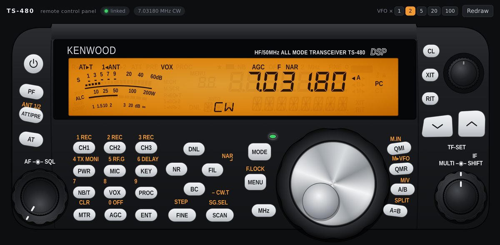

# TS-480 Panel: software replacement for the control head



This program replaces the Kenwood TS-480 control panel (control head) with a
web page. It talks to the radio over the panel ↔ radio link (RJ12, 5 V TTL,
57600 Bd), not over CAT, so the radio behaves exactly as if its own panel were
connected: the same display, all keys including long presses, the VFO, MULTI
and RIT/XIT knobs, and the AF, SQL and IF SHIFT potentiometers.

```
 browser (PC / tablet / phone)
        │  WebSocket
 ts480.server  (Python, aiohttp)
        │  PanelLink: keepalive, reply to the O query, keys, encoders
        │  DisplayState: decoding of the LCD commands
 USB-UART 5 V  ──RJ12──  TS-480 main unit
```

The protocol is documented in **[PROTOCOL.md](PROTOCOL.md)**.

## Three ways to run it

| mode | the web panel… | physical panel | command |
|---|---|---|---|
| **stand-alone** | *is* the panel | disconnected | `--port <serial port to the radio>` |
| **beside the real panel** | mirrors the display and adds its own key presses | connected through `tools/bridge.py` | `--bridge 127.0.0.1:8491` |
| **simulator** | drives a built-in model of the radio | not needed | `--sim` |

## Installation

```bash
git clone … ts-480-web-panel && cd ts-480-web-panel
python3 -m venv .venv
.venv/bin/pip install -r requirements.txt
```

Python 3.10 or newer; pyserial and aiohttp are the only dependencies.

## Wiring

| RJ12 (cable from the radio) | USB-UART 5 V (FTDI TTL-232R-5V, CH340 in 5 V mode…) |
|---|---|
| 3 GND | GND |
| 4 RDO (radio → panel) | **RX** |
| 5 TDO (panel → radio) | **TX** |
| 6 AF + 1 SPK GND | to an AF amplifier / sound card (the panel does not process audio) |
| 2 +8 V | do not connect |

* 5 V TTL, **not RS-232** – never connect a ±12 V converter to pins 4 and 5.
* Only one panel may drive the TX line: in stand-alone mode the physical
  panel must be unplugged.
* For running beside the real panel the cable is cut and both halves go to two
  adapters (radio side and panel side), see below.

## Running

### Stand-alone (the web panel replaces the panel)

```bash
.venv/bin/python -m ts480.server --port /dev/ttyUSB0          # Windows: --port COM5
.venv/bin/python -m ts480.server --port socket://192.168.1.50:4000   # UART over the network (ser2net, ESP32…)
```

Open http://127.0.0.1:8480 and press ⏻ to switch the radio on.

* The server answers the radio's keepalives (`FF` every 5 s) and its `O`
  query with the positions of AF, SQL and IF SHIFT. **The radio switches itself
  off about 4 s after the panel stops answering**, so stopping the server
  switches the radio off.
* The web panel starts with **AF at 0** (silent); turn the AF knob up.
* ⏻ works like the real key: `01` switches the radio on, `00` switches it off.

### Beside the real panel

Cut the panel cable and connect both halves to USB-UART adapters. The bridge
copies every byte between panel and radio, logs both directions and offers a
tap for the web panel:

```bash
RADIO=/dev/ttyUSB0 PANEL=/dev/ttyUSB1 tools/bridge.sh start     # stop | restart | status
.venv/bin/python -m ts480.server --bridge 127.0.0.1:8491
```

* The web panel shows the same display as the physical one and its keys and
  knobs are injected into the line as if the physical panel had sent them; both
  can be used at the same time.
* The physical panel answers the keepalives, so it must stay connected and on.
* `tools/bridge.sh restart` restarts the bridge with a gap of ~0.2 s, short
  enough that the radio stays on.

### Stand-alone with full logging

A pair of virtual serial ports takes the place of the panel cable, so the
bridge logs every byte while the web panel is the only panel:

```bash
socat pty,raw,echo=0,link=$PWD/logs/vpanel-a pty,raw,echo=0,link=$PWD/logs/vpanel-b &
.venv/bin/python -m ts480.server --port $PWD/logs/vpanel-b
RADIO=/dev/ttyUSB0 PANEL=$PWD/logs/vpanel-a tools/bridge.sh start
```

### Simulator

```bash
.venv/bin/python -m ts480.server --sim
```

### Options

| option | default | meaning |
|---|---|---|
| `--port PORT` | – | serial port or pyserial URL of the line to the radio |
| `--bridge HOST:PORT` | – | tap of `tools/bridge.py` |
| `--sim` | – | built-in simulator |
| `--http HOST:PORT` | `127.0.0.1:8480` | address of the web page |
| `--long-press S` | `1.0` | seconds a key must be held for a long press |
| `-v` | | verbose log |

The serial line runs at 57600 Bd, 8 data bits, no parity, 2 stop bits.
`--http 0.0.0.0:8480` makes the panel reachable from the network – anyone who
can open the page can operate the radio, including transmitting, so only do
this on a trusted network or use an SSH tunnel
(`ssh -L 8480:127.0.0.1:8480 user@host`).

## Using the web panel

* **Keys**: click or touch. Holding a key for more than 1 s sends a long press
  (the second function printed in orange above the key).
* **Knobs**: drag in a circle or use the mouse wheel (Shift = ×10). AF/SQL and
  MULTI/IF SHIFT are concentric: the outer ring and the inner knob are
  separate controls. Double-click the IF SHIFT ring to centre it.
* **Keyboard**: `↑`/`↓` tune the VFO, `PgUp`/`PgDn` turn MULTI.
* **VFO ×** (top right): how many encoder counts one knob step sends
  (one count is about 5 Hz in normal tuning).
* **Display**: frequency, sub-display, mode, S/PO meter, ALC/SWR/COMP meter and
  every icon as sent by the radio. Texts that the real panel draws from its own
  memory are drawn here too:
  menu descriptions (menu 00–60) and setting read-outs such as `PWR-  30`,
  `HI- 2400`, `NB LV.- 6` or `TX TUNE`. The display brightness (menu 00, `oFF`
  = backlight off) and the key illumination (menu 01) follow the radio.
* **Direct frequency**: enters a frequency through the keypad (ENT, digits, ENT).
* **Raw frames**: sends any frame to the radio (`N1` or `hex: 4E 31`).
* **Redraw**: asks the radio to resend the whole display (`02`).
* **Decoded state** and **Traffic**: what the radio sent, decoded, and the
  traffic in both directions (keepalives hidden).

## Debugging and research tools

| tool | what it does |
|---|---|
| `tools/bridge.py`, `tools/bridge.sh` | in-line bridge: forwards, logs (`logs/console.txt`, `logs/bridge-*.jsonl`), text injection on TCP 8490 (`radio E1`, `panel ;0145000`), binary tap on TCP 8491 |
| `tools/sniff.py` | passive tap with two RX-only adapters |
| `tools/cat_probe.py` | sends CAT commands or injected panel frames and prints what the radio then sent to the panel |
| `tools/cat_proxy.py`, `tools/catlink.py` | shares the CAT port between Kenwood ARCP-480 (under wine) and scripts |
| `tools/xctl.py` | clicks, types and takes screenshots in an X display (ARCP-480 in Xvfb) |
| `tools/menu_backup.py` | backs up, compares and restores all menu settings (Menu A and B) over CAT |
| `tools/menu_scan.py` | walks through the menu and photographs the real panel (menu texts) |
| `tools/key_test.py` | presses keys through the web panel and puts the real LCD (camera), the web panel and ARCP-480 side by side |

The tables `KEYS`, `FLAG_LABELS` and `MODE_NAMES` in `ts480/protocol.py` and
`MENU` / `SUBMODE` in `ts480/web/index.html` are the places to correct.

## Files

* `ts480/protocol.py`: codec (frames, keys, encoders, display parser)
* `ts480/link.py`: the panel's side of the line (keepalive, `O` query, POWER, key timing, encoders)
* `ts480/server.py`: web server and WebSocket API
* `ts480/web/index.html`: the panel (SVG, measured on a front photo of the real panel)
* `ts480/sim.py`: simplified simulator of the main unit
* `tools/`: see above
* `tests/`: tests against traffic captured from a real radio

## Status

Verified on a real TS-480HX (2026-11-13/14) with the bridge, CAT, a camera on
the real panel and ARCP-480:

* framing, keepalive (radio `FF` every 5 s, power-off ~4 s without an answer),
  power on/off, redraw, `O` query
* every key code (short and long press), VFO, MULTI, RIT/XIT, AF, SQL, IF SHIFT
* frequency and decimal points, mode digit (= CAT `MD`), meters, almost all icons
* menu mode and all setting read-outs (the radio sends only numbers, the
  panel draws the texts)
* stand-alone operation without the physical panel

Still unknown: icon bits `B0`/`B1` (EQ), parts of `D`/`E`, the `L` byte, `R n`,
the scale of the second meter value. Memory channels, Tone/CTCSS in FM and
TF-SET in split were not tested.

## Credits and sources

* **[Stian Eklund, stianeklund/TS-480-Panel](https://github.com/stianeklund/TS-480-Panel)**
  (GPL-3.0): the reverse engineering of the panel ↔ radio protocol this project
  is built on (logic analyzer captures, key codes, display commands, timing).
  The power-on dump used in `tests/test_protocol.py` comes from its
  `Radio/Power on sequence.md`.
* RemoteRig documentation of the TS-480 separated control head operation.
* Kenwood TS-480SAT/HX instruction manual (panel layout, key functions, menu).

## License

This program is free software: you can redistribute it and/or modify it under
the terms of the GNU General Public License as published by the Free Software
Foundation, either version 3 of the License, or (at your option) any later
version. See [LICENSE](LICENSE).

Kenwood and TS-480 are trademarks of JVCKENWOOD Corporation. This project is
not affiliated with or endorsed by Kenwood.
